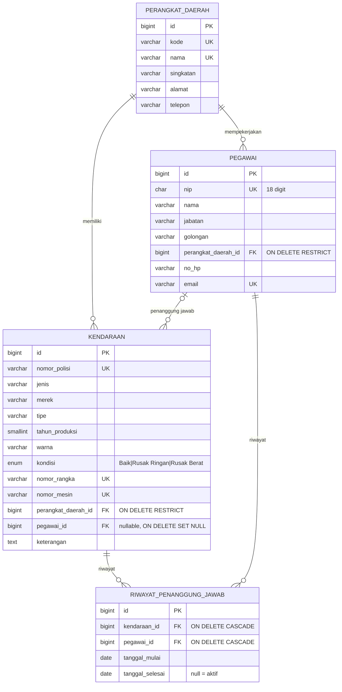

# SIM KDO — Sistem Informasi Kendaraan Dinas Operasional

Aplikasi pengelolaan data **Kendaraan Dinas Operasional (KDO)** milik Perangkat Daerah sebagai bagian dari
pengelolaan Barang Milik Daerah (BMD): pendataan kendaraan, kondisi kendaraan, dan pegawai (PNS) penanggung jawab.

**Track: Full Stack.** Web UI (Laravel Blade + Tailwind CSS) dan REST API (Laravel + Sanctum) memakai
model, validasi, dan basis data yang sama.

> Repositori ini adalah **solusi acuan** soal Ujian Praktik Junior Programmer (JP) untuk pembanding penilaian.

## Fitur

| Area | Fitur |
|---|---|
| Kendaraan Dinas | CRUD; cari (nopol/merek/tipe); filter kondisi, jenis, perangkat daerah; paginasi; detail dengan riwayat penanggung jawab; **ekspor CSV** sesuai filter |
| Pegawai (PNS) | CRUD; cari nama/NIP/jabatan; filter perangkat daerah; detail kendaraan yang dipegang + riwayat |
| Perangkat Daerah | CRUD; detail berisi daftar pegawai dan kendaraannya |
| Dashboard | Total kendaraan/pegawai/PD, komposisi kondisi & jenis, rekap per PD, daftar kendaraan rusak |
| Riwayat penanggung jawab | *(entitas tambahan)* tercatat otomatis (observer) setiap penanggung jawab ditetapkan/diganti |
| REST API | Token Bearer (Sanctum), CRUD 3 entitas + dashboard, filter & paginasi, error JSON konsisten, rate limit |
| Dokumentasi API | OpenAPI 3 (`public/openapi.yaml`) + Swagger UI di **`/docs`** |
| Keamanan dasar | Login wajib, CSRF, password di-hash, throttle login (5/menit), validasi server-side, mass assignment dibatasi `Fillable` |

### Aturan bisnis yang divalidasi

- Nomor polisi unik dan berformat `B 1234 PQA` (input dinormalisasi: huruf besar, spasi tunggal).
- Nomor rangka & nomor mesin unik (opsional). Tahun produksi 1980 s.d. tahun depan.
- Kondisi hanya `Baik`, `Rusak Ringan`, `Rusak Berat`. Jenis: `Roda 2`, `Roda 4`, `Roda 6`.
- NIP 18 digit dan unik (spasi saat mengetik diabaikan). Golongan I/a s.d. IV/e.
- **Penanggung jawab harus pegawai dari perangkat daerah pemilik kendaraan.**
- Perangkat daerah yang masih punya pegawai/kendaraan **tidak bisa dihapus** (web: pesan; API: `409`).
- Pegawai yang masih menjadi penanggung jawab kendaraan tidak bisa dihapus atau dipindah PD.

## Rancangan Basis Data



Dump MySQL (struktur + data contoh): [`database/dump/kdo_db.sql`](database/dump/kdo_db.sql).

## Teknologi

PHP 8.4 · Laravel 13 · Laravel Sanctum · MySQL 8 (atau SQLite) · Blade + Tailwind CSS 4 (Vite) · PHPUnit · Swagger UI

## Instalasi

Prasyarat: PHP ≥ 8.3 (ekstensi `pdo_mysql`), Composer, Node.js ≥ 20, MySQL 8.

```bash
git clone <url-repo> kdo-app && cd kdo-app
composer install
npm install && npm run build
cp .env.example .env
php artisan key:generate
```

Pilih **salah satu** cara menyiapkan database:

```bash
# A. Lewat migrasi + seeder (disarankan)
mysql -u root -p -e "CREATE DATABASE kdo_db CHARACTER SET utf8mb4 COLLATE utf8mb4_unicode_ci"
php artisan migrate --seed

# B. Impor dump SQL (database kdo_db dibuat otomatis)
mysql -u root -p < database/dump/kdo_db.sql
```

Tanpa MySQL: ubah `.env` menjadi `DB_CONNECTION=sqlite` (hapus baris `DB_*` lain), lalu `php artisan migrate --seed`.

Jalankan:

```bash
php artisan serve
```

Buka http://localhost:8000 — dokumentasi API di http://localhost:8000/docs.

**Akun demo (dari seeder):** `admin@kdo.test` / `password`

## REST API

Base URL `/api`, format JSON. Kirim header `Accept: application/json` dan `Authorization: Bearer <token>`.

| Metode | Endpoint | Keterangan |
|---|---|---|
| POST | `/login` | Dapatkan token (`email`, `password`) |
| GET | `/me` · POST `/logout` | Profil · cabut token |
| GET | `/dashboard` | Ringkasan statistik |
| GET, POST | `/kendaraan` | Daftar (`q`, `kondisi`, `jenis`, `perangkat_daerah_id`, `page`, `per_page`) · tambah |
| GET, PUT, DELETE | `/kendaraan/{id}` | Detail (+ riwayat) · ubah · hapus |
| GET, POST | `/pegawai` | Daftar (`q`, `perangkat_daerah_id`) · tambah |
| GET, PUT, DELETE | `/pegawai/{id}` | Detail · ubah · hapus (`409` bila masih penanggung jawab) |
| GET, POST | `/perangkat-daerah` | Daftar (`q`) · tambah |
| GET, PUT, DELETE | `/perangkat-daerah/{id}` | Detail · ubah · hapus (`409` bila masih dipakai) |

Kode status: `200`, `201`, `401` (tanpa/invalid token), `404`, `405`, `409` (konflik relasi), `422` (validasi), `429` (rate limit).

Contoh:

```bash
TOKEN=$(curl -s -X POST localhost:8000/api/login -H 'Accept: application/json' \
  -d email=admin@kdo.test -d password=password | php -r 'echo json_decode(stream_get_contents(STDIN))->access_token;')
curl -s "localhost:8000/api/kendaraan?kondisi=Rusak%20Berat" -H "Authorization: Bearer $TOKEN" -H 'Accept: application/json'
```

## Pengujian

```bash
php artisan test
```

21 feature test (129 assertion) mencakup autentikasi API, CRUD ketiga entitas, validasi format/keunikan,
aturan penanggung jawab satu PD, penolakan hapus (409), riwayat penanggung jawab, halaman web, dan ekspor CSV.

## Screenshot

Folder [`docs/screenshots`](docs/screenshots):

| Web | REST API (Swagger UI, request nyata) |
|---|---|
| `01-login`, `02-dashboard` | `20-api-docs-swagger` |
| `03-kendaraan-list`, `04-kendaraan-filter-rusak-berat` | `21-api-login` |
| `05-kendaraan-detail`, `06/08` form tambah/ubah | `22-api-kendaraan-list` |
| `07-kendaraan-form-validasi` | `23-api-kendaraan-create-201`, `24-...-422` |
| `09–11` pegawai list/detail/form | `25-api-kendaraan-detail` |
| `12–14` perangkat daerah list/detail/hapus ditolak | `26-api-pegawai-delete-409`, `27-api-dashboard` |

## Struktur Proyek (ringkas)

```
app/Http/Controllers/          Controller web (Blade)
app/Http/Controllers/Api/      Controller REST API
app/Http/Requests/             Validasi (dipakai bersama web & API)
app/Http/Resources/            Bentuk respons JSON
app/Models/                    PerangkatDaerah, Pegawai, Kendaraan, RiwayatPenanggungJawab
app/Observers/                 KendaraanObserver (pencatat riwayat)
app/Services/StatistikKdo.php  Statistik dashboard (web & API)
app/Support/Referensi.php      Daftar kondisi, jenis, golongan
database/migrations|seeders    Skema & data contoh
database/dump/kdo_db.sql       Dump MySQL
public/openapi.yaml            Spesifikasi OpenAPI
resources/views/               Tampilan Blade
tests/Feature/                 Feature test web & API
```

## Penggunaan AI

Aplikasi ini **dibangun dengan bantuan AI**: Claude Code (aplikasi desktop Claude) dengan model **Claude Opus 5.5**.
AI dipakai untuk menyusun kode, migrasi, seeder, tampilan, dokumentasi API, pengujian, dan README ini,
berdasarkan soal ujian JP. Rincian instruksi dan keputusan yang diambil ada di [`AGENTS.md`](AGENTS.md).

Catatan: data seeder (nama pegawai, NIP, nomor polisi, nomor rangka/mesin) adalah **fiktif**;
nama dan alamat perangkat daerah hanya contoh.
